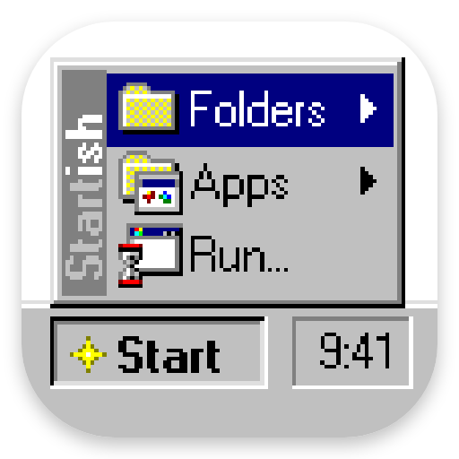
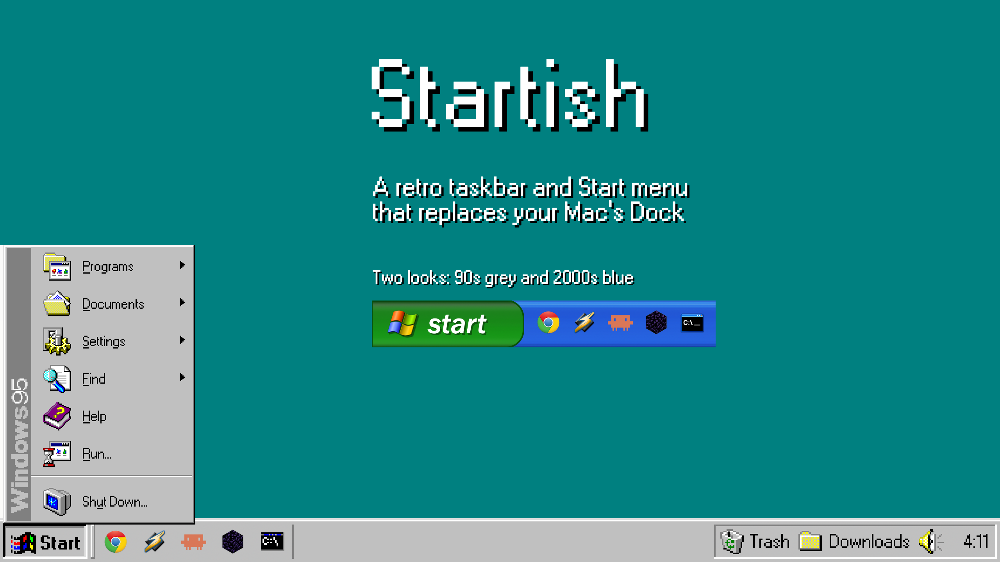

<p align="center">
  
  <h1 align="center">Startish</h1>
  <p align="center">
    <strong>A 90s and 2000s style taskbar and Start menu for your Mac. Replaces the Dock.</strong>
  </p>
  <p align="center">
    <a href="https://hamzabrahman.gumroad.com/l/startish"></a>
    <a href="https://github.com/hamzamohamedsg/startish-releases/releases/latest/download/Startish.zip"></a>
    
    
    
  </p>
</p>

---

<p align="center">
  
</p>

The Mac Dock is fine. But you remember a grey bar with a **Start** button, a clock in the corner, and one button for every open window.

**Startish** brings that back: a pixel-exact retro taskbar along the bottom of every screen, in 90s grey or 2000s blue.

---

## ⚡ Features

- **Start menu**: Programs, Documents, Settings, Find, Help, Run... and Shut Down..., all working on your Mac.
  - **Type to search** your apps, or do quick sums (`12*3`, Return copies the answer).
  - Open it with a **keyboard shortcut** of your choice, even a tap of Left Command.
- **One button per window**: click to switch, click again to minimize, right-click for the app's own Dock menu.
- **Quick launch**: pin your favorite apps next to Start.
- **Folder menus in the tray**: pin folders (like Downloads) and browse them in pop-up menus, newest at the bottom, updating live.
- **Tray**: working volume control and a clock that follows your 12/24-hour setting.
- **Two looks**: 90s grey and 2000s blue, with optional sounds.
- **Auto hide**, **every display**, and it **gets out of the way** for full-screen apps and games.
- **Sharp at any size**: drawn pixel by pixel at 1× to 4×, never blurry.
- **Automatic updates** from inside the app.
- **Private**: no tracking, no analytics.

---

## 📥 Installation

1. Download **[Startish.zip](https://github.com/hamzamohamedsg/startish-releases/releases/latest/download/Startish.zip)** and unzip it.
2. Drag **Startish** into your **Applications** folder and open it.
3. macOS will say it can't check Startish for malicious software. Go to **System Settings > Privacy & Security**, scroll down, click **Open Anyway**, then **Open**. You only do this once.
4. Startish asks for **Accessibility** access, which it needs to show a button for each window. Click **Open Settings** and turn on Startish.

Your Dock hides while Startish runs and comes back when you quit.

---

## 🔑 Free Trial and License

- Startish runs free for **1 day**, no sign-up.
- To keep using it, [**buy a license for $12**](https://hamzabrahman.gumroad.com/l/startish) (one-time, free updates). Your key arrives in your receipt email.
- Enter it from the menu bar icon: **Enter License Key…**. One key works on up to 3 Macs.
- Lost your key? Open the [product page](https://hamzabrahman.gumroad.com/l/startish) and click **Already bought this?**.

---

## 🧹 Uninstalling

1. Click the Startish icon in the menu bar and choose **Quit Startish**. Your Dock comes back as it was.
2. Delete Startish from Applications.

If the Dock is still hidden (for example, Startish was deleted while running), paste this in Terminal:

```bash
defaults delete com.apple.dock autohide-delay; defaults delete com.apple.dock tilesize; defaults write com.apple.dock autohide -bool false; killall Dock
```

---

## 🔒 Privacy

Startish collects nothing. It only goes online to check your license key with Gumroad (about once a week) and to look for updates here. A web search opens in your browser only when you choose **Search the web** in the Start menu.

---

<sub>Not affiliated with or endorsed by Microsoft. Windows is a trademark of Microsoft Corporation.</sub>
